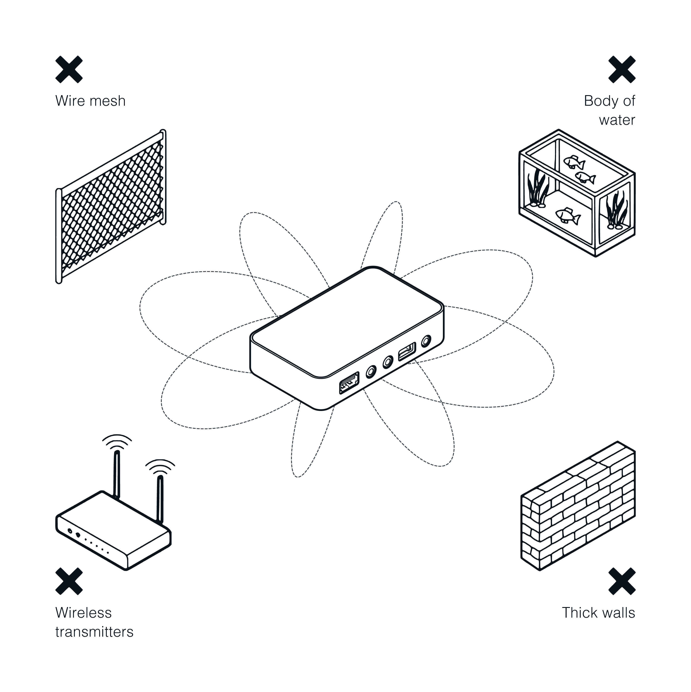

---
zendesk:
  article_id: 40528741239965
  name: "Choosing a location for Connect AUX-2"
  position: 30
  labels: connect aux-2
---

Choose a spot for Home Assistant Connect AUX-2 before installing it:

- **Cabling:** for Power over Ethernet (PoE), keep it within reach of a PoE switch or injector. Otherwise, place it near a USB-C supply and your network.
- **Audio:** keep it close enough to your amplifier, AV receiver, or active speakers for the cable run.
- **Wireless:** if you use Wi-Fi or the Bluetooth proxy, keep it in the open. Don't bury it behind or underneath other equipment, or inside a closed cabinet. For the best Wi-Fi and Bluetooth proxy performance, also keep it away from the spots below. On a wired connection without the Bluetooth proxy, they don't matter.

    

- **Connect ZWA-2:** if you plug a Connect ZWA-2 into Connect AUX-2, also follow [Finding an installation location for the Home Assistant Connect ZWA-2](/hc/en-us/articles/28670284336925).
