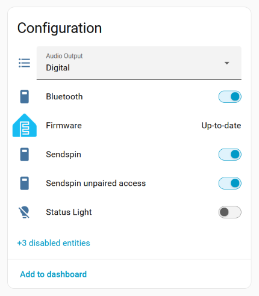

---
zendesk:
  article_id: 40528779913373
  name: "Streaming audio with Sendspin"
  position: 10
  labels: connect aux-2
---

Home Assistant Connect AUX-2 plays audio through its 3.5 mm audio output to a stereo, AV receiver, or active speakers. Unpowered speakers need an audio amplifier.

Connect AUX-2 plays audio through Sendspin, which keeps it in sync with your other speakers. Use Music Assistant to play audio on it.

To get started, follow the [Connect AUX-2 audio guide](https://www.nabucasa.com/hardware/aux-2/audio/).

## What Sendspin is

[Sendspin](https://www.sendspin-audio.com/) is an open standard from the Open Home Foundation for synchronized whole-home audio. A Sendspin source sends audio to the Sendspin speakers on your network, and they play it in sync, with no cloud service or account.

Connect AUX-2 is a native Sendspin player. It outputs audio from any Sendspin source to the audio equipment connected to it. [Music Assistant](https://www.music-assistant.io/) is a free Sendspin source that works with Home Assistant.

Sendspin is on by default. To turn it off, turn off the **Sendspin** switch on the Connect AUX-2 device page in Home Assistant.

## Connect the audio output

The audio output is a single 3.5 mm jack that plays either analog or digital audio, one at a time. Connect AUX-2 detects the cable you plug in and sets **Audio Output** to match:

| Audio Output setting | What the jack plays | Cable to use |
| --- | --- | --- |
| **Analog** | Analog stereo audio | 3.5 mm audio cable, for example 3.5 mm to RCA |
| **Digital** | Optical (S/PDIF) digital audio | Mini-TOSLINK optical cable, for example mini-TOSLINK to TOSLINK |

To find the **Audio Output** setting:

1. In Home Assistant, go to **Settings** > **Devices & services** > **ESPHome**.
2. Select Connect AUX-2.
3. Find **Audio Output** on the **Configuration** card.



Connect audio equipment to the 3.5 mm audio output only, never to RS-232 Port 1 or Port 2. See [the port warning in Ports and controls](/hc/en-us/articles/40528853274909).



Common connections are a pair of RCA inputs, white for left and red for right, often labeled AUDIO IN, or a 3.5 mm input labeled AUX.



For digital audio, use a mini-TOSLINK to TOSLINK cable and connect it to an optical input, often labeled OPTICAL.



## Analog or digital output

Connect AUX-2 sets **Audio Output** to **Analog** or **Digital** automatically, based on the cable you plug in. With **Digital** set and a mini-TOSLINK cable plugged in, a red light glows inside the audio output.

If Connect AUX-2 doesn't detect your cable correctly, set the output yourself:

1. In Home Assistant, go to **Settings** > **Devices & services** > **ESPHome** and select Connect AUX-2.
2. Enable the **Automatic output mode selection** entity, which is disabled by default:
    1. Expand the **entity not shown** section to see disabled entities.
    2. Select **Automatic output mode selection**, select the cogwheel, and turn on **Enable**.
    3. Select **Update**, then select **OK**. The entity takes about 30 seconds to become enabled.
3. Turn off **Automatic output mode selection**.
4. Under **Configuration**, set **Audio Output** to **Analog** or **Digital** to match your cable.

Connect AUX-2 remembers the setting after a restart.

## Play audio with Music Assistant

Any Sendspin source can play audio on Connect AUX-2. With Music Assistant, Connect AUX-2 works as a synchronized player with interruption-free announcements:

1. Make sure Music Assistant is installed and running.
2. Music Assistant discovers Connect AUX-2 automatically as a Sendspin player.
3. Name it during setup, for example "Living Room AUX-2".
4. Group it with other players for whole-home audio. For best results, group native Sendspin players together, for example Connect AUX-2 and Voice Preview Edition.



If you hear no audio, see [Troubleshooting](/hc/en-us/articles/40528982833565).

## Related integrations

- [Music Assistant](https://www.home-assistant.io/integrations/music_assistant/)
